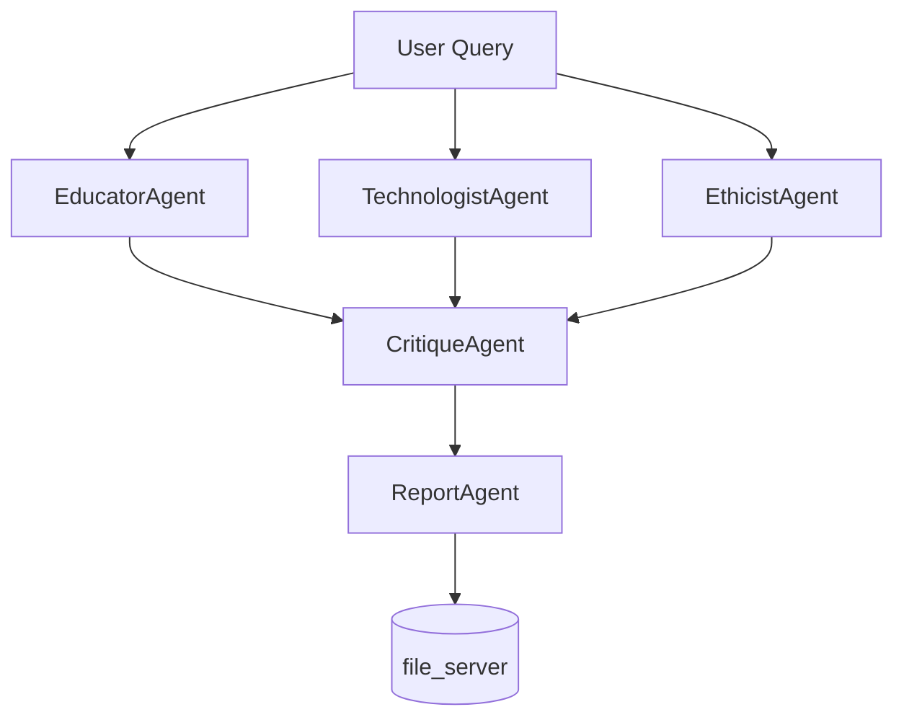

# Feature: MADA Workflow Planner UI

## Overview

A web-based planning interface that lets users describe a task in natural language, then automatically designs a multi-agent workflow — selecting agents, assigning MCP servers, defining inter-agent connections, and visualizing the execution graph. The user reviews and modifies the plan before the system generates both executable Python code and a reusable MADA orchestrator JSON config.

---

## User Flow

```
[User describes task] -> [Planner generates agent graph] -> [User reviews/edits plan]
     -> [User approves] -> [System generates code + JSON config] -> [Execute or export]
```

### Step 1: Task Input

The user opens the Workflow Planner UI and describes what they want to accomplish in a free-form text box.

**Example input:**
> "Analyze the pros and cons of AI in education. Get perspectives from an educator, a technologist, and an ethicist. Have a critic review the arguments, then produce a final balanced report."

### Step 2: Plan Generation

The planner LLM analyzes the task and produces a structured plan:

- **What agents are needed** — names, roles, system instructions
- **What MCP servers each agent connects to** (if any) — from available servers or "none" for reasoning-only agents
- **How agents connect** — execution order, data flow, dependencies
- **Orchestration strategy** — `agent-as-tool` or `magentic` and why

The plan is returned as structured JSON internally but displayed as a visual graph + detail panel to the user.

### Step 3: Interactive Review

The user sees:

1. **Workflow Graph** — a directed graph showing agents as nodes and data flow as edges
2. **Agent Detail Panel** — click any agent to see/edit its name, description, domain, instructions, and MCP server assignments
3. **Execution Order** — numbered steps showing which agents run when
4. **Orchestration Settings** — strategy type, max turns, model selection

The user can:
- Add, remove, or rename agents
- Reassign MCP servers
- Edit agent instructions
- Change execution order or dependencies
- Switch orchestration strategy
- Approve or regenerate the plan

### Step 4: Code & Config Generation

On approval, the system generates:

1. **MADA JSON config** — a complete config file ready for `mada-orchestrator` or `mada-gradio`
2. **Python code** — standalone script using the MADA orchestrator API directly
3. **Execution option** — run the workflow immediately from the UI

---

## Walkthrough: "Pros and Cons of AI in Education"

### User Input

```
Analyze the pros and cons of AI in education. Get perspectives from
an educator, a technologist, and an ethicist. Have a critic review
all arguments, then produce a final balanced report.
```

### Generated Plan

#### Agents

| Agent | Domain | Role | MCP Servers |
|-------|--------|------|-------------|
| EducatorAgent | education | Argues from a teacher/pedagogy perspective on AI in classrooms | none |
| TechnologistAgent | technology | Covers technical capabilities, limitations, and implementation realities | none |
| EthicistAgent | ethics | Examines fairness, bias, privacy, equity, and societal impact | none |
| CritiqueAgent | critique | Reviews all perspectives for logical gaps, bias, missing evidence | none |
| ReportAgent | synthesis | Synthesizes all inputs into a balanced, structured final report | file_server |

#### Orchestration Strategy: `magentic`

**Why magentic**: The task requires multi-turn deliberation where agents build on each other's output. The manager agent orchestrates rounds — first gathering perspectives, then running critique, then synthesizing. This is preferable to `agent-as-tool` here because the agents need to see and respond to each other's work, not just be called independently.

#### Execution Graph

```
                    +------------------+
                    |   User Query     |
                    +--------+---------+
                             |
              +--------------+--------------+
              |              |              |
     +--------v---+  +------v------+  +----v--------+
     | Educator   |  | Technologist|  | Ethicist    |
     | Agent      |  | Agent       |  | Agent       |
     +--------+---+  +------+------+  +----+--------+
              |              |              |
              +--------------+--------------+
                             |
                    +--------v---------+
                    |  CritiqueAgent   |
                    |  (reviews all 3) |
                    +--------+---------+
                             |
                    +--------v---------+
                    |  ReportAgent     |
                    |  (final report)  |---> file_server (save report)
                    +------------------+
```

#### Agent Details

**EducatorAgent**
```
Name: EducatorAgent
Domain: education
MCP Servers: []
Instructions: You are EducatorAgent, an experienced K-12 and higher education
professional. Analyze AI in education from a pedagogical perspective. Cover:
personalized learning, teacher workload, student engagement, assessment integrity,
digital divide, and classroom dynamics. Ground arguments in real teaching scenarios.
Provide both benefits and concerns from an educator's standpoint.
```

**TechnologistAgent**
```
Name: TechnologistAgent
Domain: technology
MCP Servers: []
Instructions: You are TechnologistAgent, a senior AI/ML engineer with education
technology experience. Analyze AI in education from a technical perspective. Cover:
current capabilities (NLP tutoring, adaptive learning, automated grading), technical
limitations (hallucination, context windows, domain accuracy), implementation costs,
data requirements, and scalability. Be honest about what AI can and cannot reliably
do today.
```

**EthicistAgent**
```
Name: EthicistAgent
Domain: ethics
MCP Servers: []
Instructions: You are EthicistAgent, specializing in technology ethics and AI
governance. Analyze AI in education through an ethical lens. Cover: student data
privacy, algorithmic bias in assessment, equity of access, informed consent for
minors, surveillance concerns, intellectual property, and the philosophical
implications of AI-mediated learning. Reference relevant frameworks (UNESCO AI
ethics, FERPA, GDPR for minors).
```

**CritiqueAgent**
```
Name: CritiqueAgent
Domain: critique
MCP Servers: []
Instructions: You are CritiqueAgent, a rigorous analytical reviewer. You receive
perspectives from the Educator, Technologist, and Ethicist agents. Your job:
identify logical gaps, unsupported claims, contradictions between perspectives,
missing stakeholder viewpoints (students, parents, administrators, policymakers),
and any bias in the arguments. Provide specific, actionable feedback. Do not be
agreeable by default — challenge weak reasoning.
```

**ReportAgent**
```
Name: ReportAgent
Domain: synthesis
MCP Servers: [file_server]
Instructions: You are ReportAgent, a technical writer specializing in policy
analysis. Synthesize all prior agent outputs — the three perspectives and the
critique — into a balanced, well-structured report. Structure: Executive Summary,
Pros (categorized), Cons (categorized), Areas of Consensus, Areas of Disagreement,
Recommendations, and Conclusion. Save the final report using the file server.
Maintain a neutral, evidence-based tone throughout.
```

### Generated JSON Config

```json
{
  "model": {
    "provider": "livai",
    "model": "gpt-4o",
    "api_key": "${API_KEY}",
    "base_url": "${API_BASE_URL:-https://livai-api.llnl.gov/v1}"
  },
  "orchestration": {
    "mode": "magentic"
  },
  "agents": [
    {
      "agent_name": "EducatorAgent",
      "description": "Analyzes AI in education from a teacher/pedagogy perspective",
      "domain": "education",
      "mcp_servers": [],
      "instructions": "You are EducatorAgent, an experienced K-12 and higher education professional. Analyze AI in education from a pedagogical perspective. Cover: personalized learning, teacher workload, student engagement, assessment integrity, digital divide, and classroom dynamics. Ground arguments in real teaching scenarios. Provide both benefits and concerns from an educator's standpoint."
    },
    {
      "agent_name": "TechnologistAgent",
      "description": "Covers technical capabilities, limitations, and implementation realities of AI in education",
      "domain": "technology",
      "mcp_servers": [],
      "instructions": "You are TechnologistAgent, a senior AI/ML engineer with education technology experience. Analyze AI in education from a technical perspective. Cover: current capabilities (NLP tutoring, adaptive learning, automated grading), technical limitations (hallucination, context windows, domain accuracy), implementation costs, data requirements, and scalability. Be honest about what AI can and cannot reliably do today."
    },
    {
      "agent_name": "EthicistAgent",
      "description": "Examines fairness, bias, privacy, equity, and societal impact of AI in education",
      "domain": "ethics",
      "mcp_servers": [],
      "instructions": "You are EthicistAgent, specializing in technology ethics and AI governance. Analyze AI in education through an ethical lens. Cover: student data privacy, algorithmic bias in assessment, equity of access, informed consent for minors, surveillance concerns, intellectual property, and the philosophical implications of AI-mediated learning. Reference relevant frameworks (UNESCO AI ethics, FERPA, GDPR for minors)."
    },
    {
      "agent_name": "CritiqueAgent",
      "description": "Reviews all perspectives for logical gaps, bias, and missing evidence",
      "domain": "critique",
      "mcp_servers": [],
      "instructions": "You are CritiqueAgent, a rigorous analytical reviewer. You receive perspectives from the Educator, Technologist, and Ethicist agents. Your job: identify logical gaps, unsupported claims, contradictions between perspectives, missing stakeholder viewpoints (students, parents, administrators, policymakers), and any bias in the arguments. Provide specific, actionable feedback. Do not be agreeable by default — challenge weak reasoning."
    },
    {
      "agent_name": "ReportAgent",
      "description": "Synthesizes all inputs into a balanced, structured final report",
      "domain": "synthesis",
      "mcp_servers": ["file_server"],
      "instructions": "You are ReportAgent, a technical writer specializing in policy analysis. Synthesize all prior agent outputs — the three perspectives and the critique — into a balanced, well-structured report. Structure: Executive Summary, Pros (categorized), Cons (categorized), Areas of Consensus, Areas of Disagreement, Recommendations, and Conclusion. Save the final report using the file server. Maintain a neutral, evidence-based tone throughout."
    }
  ],
  "mcp_servers": {
    "file_server": {
      "transport": "streamable-http",
      "url": "http://localhost:8014/mcp",
      "description": "File system operations for saving the final report"
    }
  }
}
```

### Generated Python Code

```python
"""
MADA Workflow: Pros and Cons of AI in Education
Generated by MADA Workflow Planner
"""
import asyncio

from mada.core.config import load_config_from_json
from mada.core.database.session_manager import ChatSessionManager
from mada.core.orchestrator import MADAOrchestrator


CONFIG_PATH = "workflow_config.json"
QUERY = (
    "Analyze the pros and cons of AI in education. Get perspectives from "
    "an educator, a technologist, and an ethicist. Have a critic review "
    "all arguments, then produce a final balanced report."
)


async def main():
    config = load_config_from_json(CONFIG_PATH)

    session_manager = ChatSessionManager(config.database)
    session_manager.create_new_session()

    async with MADAOrchestrator(
        model_config=config.model,
        database_config=config.database,
        orchestration_config=config.orchestration,
        session_manager=session_manager,
    ) as orchestrator:
        status, tools = await orchestrator.initialize_orchestrator(
            agent_configs=config.agents,
            mcp_servers=config.mcp_servers,
        )
        print(f"Status: {status}")
        print(f"Tools available: {len(tools)}")

        print("\n--- Running Analysis ---\n")
        async for chunk in orchestrator.process_message(QUERY):
            print(chunk, end="", flush=True)
        print("\n\n--- Complete ---")


if __name__ == "__main__":
    asyncio.run(main())
```

---

## UI Components

### Layout

```
+----------------------------------------------------------------------+
|  MADA Workflow Planner                                                |
+----------------------------------------------------------------------+
|                                                                      |
|  What would you like to accomplish?                                   |
|  +----------------------------------------------------------------+  |
|  | [Large text input area]                                        |  |
|  |                                                                |  |
|  +----------------------------------------------------------------+  |
|  [ Generate Plan ]                                                   |
|                                                                      |
+----------------------------------------------------------------------+
|  Workflow Graph              |  Agent Details                        |
|                              |                                       |
|  [Interactive directed       |  Name: [EducatorAgent      ]         |
|   graph visualization        |  Domain: [education        ]         |
|   using vis.js or            |  Description: [...]                   |
|   react-flow]                |  MCP Servers: [dropdown multi-select] |
|                              |  Instructions:                        |
|  O EducatorAgent             |  +-------------------------------+    |
|  O TechnologistAgent         |  | [Editable text area]          |    |
|  O EthicistAgent             |  |                               |    |
|       \   |   /              |  +-------------------------------+    |
|        v  v  v               |                                       |
|  O CritiqueAgent             |  [ + Add Agent ] [ - Remove Agent ]   |
|        |                     |                                       |
|        v                     +---------------------------------------+
|  O ReportAgent --> file_svr  |  Orchestration Settings               |
|                              |  Strategy: [magentic v]           |
|                              |  Max Turns: [30]                      |
|                              |  Model: [gpt-4o v]                    |
+----------------------------------------------------------------------+
|  Execution Steps                                                     |
|  1. EducatorAgent, TechnologistAgent, EthicistAgent (parallel)       |
|  2. CritiqueAgent reviews all three outputs                          |
|  3. ReportAgent synthesizes final report, saves to file_server       |
+----------------------------------------------------------------------+
|                                                                      |
|  [ Regenerate Plan ]  [ Approve & Generate Code ]  [ Execute Now ]   |
|                                                                      |
+----------------------------------------------------------------------+
|  Generated Output                                                    |
|  [Tab: JSON Config] [Tab: Python Code] [Tab: Execution Log]         |
|  +----------------------------------------------------------------+  |
|  | {                                                              |  |
|  |   "model": { ... },                                           |  |
|  |   "agents": [ ... ],                                          |  |
|  |   ...                                                         |  |
|  | }                                                              |  |
|  +----------------------------------------------------------------+  |
|  [ Download JSON ] [ Download Python ] [ Copy to Clipboard ]        |
+----------------------------------------------------------------------+
```

### Technology Choices

> **Note: Do NOT use Gradio for this UI.** The planner UI uses a modern web stack.

| Component | Technology | Rationale |
|-----------|-----------|-----------|
| Frontend framework | Next.js 14 (App Router) + React 18 + TypeScript | Full control over layout, interactive graphs, modern DX |
| Graph visualization | @xyflow/react | Interactive directed graph with drag/zoom, agent nodes |
| Code display | Monaco Editor or react-syntax-highlighter | Syntax highlighting for JSON and Python |
| Styling | Tailwind CSS | Utility-first, rapid UI development |
| Backend | FastAPI (Python) | Async, serves planner API, connects to MADA orchestrator |
| State management | React state + Context | Hold plan data across interactions |

---

## Implementation Architecture

### New Modules

```
planner-ui/                          # Next.js 14 frontend
  app/
    layout.tsx                       # Root layout
    page.tsx                         # Main planner page
    globals.css                      # Tailwind + global styles
  components/
    TaskInput.tsx                    # Free-form task input
    WorkflowGraph.tsx               # @xyflow/react agent graph
    AgentDetailPanel.tsx            # Edit agent properties
    ExecutionSteps.tsx              # Ordered step display
    OrchestrationSettings.tsx       # Strategy, model, max turns
    CodeOutput.tsx                  # Tabbed JSON/Python/Log viewer
    ActionBar.tsx                   # Regenerate / Approve / Execute buttons
  lib/
    api.ts                          # FastAPI client helpers
    types.ts                        # TypeScript types matching plan schema
  package.json
  tsconfig.json
  tailwind.config.ts
  next.config.js

src/mada/
  interfaces/
    planner/
      __init__.py
      api.py                # FastAPI app with endpoints
      planner_agent.py      # LLM-based planning logic
      code_generator.py     # Python code generation from plan
      config_generator.py   # JSON config generation from plan
      plan_schema.py        # Pydantic models for the plan structure
```

### Plan Schema

```python
from pydantic import BaseModel
from typing import Optional

class PlannedAgent(BaseModel):
    agent_name: str
    description: str
    domain: str
    mcp_servers: list[str]
    instructions: str
    depends_on: list[str]  # agent names this agent receives input from

class PlannedWorkflow(BaseModel):
    task_description: str
    orchestration_type: str  # "agent-as-tool" or "magentic"
    max_turns: int
    model: str
    agents: list[PlannedAgent]
    execution_steps: list[dict]  # ordered steps with parallel groupings
    reasoning: str  # why these agents/strategy were chosen
```

### Planner Agent

The planner uses an LLM call with a structured prompt:

1. **System prompt** describes the MADA orchestrator capabilities, available MCP servers, orchestration strategies, and agent design patterns
2. **User query** is the task description
3. **Output** is a `PlannedWorkflow` JSON (enforced via function calling or structured output)

The planner has knowledge of:
- All registered MCP servers and their capabilities
- Both orchestration strategies and when to use each
- Agent design best practices (single responsibility, clear instructions, meaningful domains)

### Config Generator

Converts `PlannedWorkflow` -> MADA JSON config dict. Straightforward mapping since the plan schema mirrors the config schema, with the addition of `depends_on` for graph rendering.

### Code Generator

Converts `PlannedWorkflow` -> standalone Python script string using a Jinja2 template or f-string template. The generated code uses the public MADA orchestrator API.

### Graph Rendering (Frontend — @xyflow/react)

The `WorkflowGraph.tsx` component renders agents as custom React Flow nodes with edges showing data flow. Each node displays agent name, domain badge, and MCP server indicators. Clicking a node opens the AgentDetailPanel for editing.



---

## Entry Points

### Backend (FastAPI)

Add to `pyproject.toml`:

```toml
[project.scripts]
mada-planner-api = "mada.interfaces.planner.api:main"
```

CLI usage:
```bash
mada-planner-api                    # launches API on default port 8000
mada-planner-api --port 8000        # custom port
```

### Frontend (Next.js)

```bash
cd planner-ui
npm run dev                          # launches on http://localhost:3000
npm run build && npm start           # production build
```

---

## Scope

### MVP (Phase 1)
- Free-form task input
- LLM-based plan generation with agent graph
- Mermaid-based workflow visualization
- Editable agent table (name, description, domain, instructions, MCP servers)
- Orchestration strategy selector
- JSON config generation + download
- Python code generation + download

### Phase 2
- Interactive graph editing (drag to add/remove edges)
- Execute workflow directly from planner UI
- Plan history / saved plans
- Template library (common workflow patterns)
- MCP server auto-discovery and health check

### Phase 3
- Iterative refinement ("add another agent", "change the critic to be harsher")
- Cost estimation (token usage prediction)
- A/B comparison of different orchestration strategies
- Export to other formats (Docker Compose, Kubernetes jobs)

---

## Dependencies

### Backend (Python — add to pyproject.toml)
- `fastapi` — async API framework
- `uvicorn` — ASGI server
- `openai` (already installed, used for planner LLM calls)
- `pydantic>=2.0` — request/response models (may already be a transitive dep)

### Frontend (Node.js — planner-ui/package.json)
- `next@14` — App Router framework
- `react@18` / `react-dom@18`
- `typescript`
- `@xyflow/react` — interactive graph visualization
- `tailwindcss` — styling
- `@monaco-editor/react` or `react-syntax-highlighter` — code display
